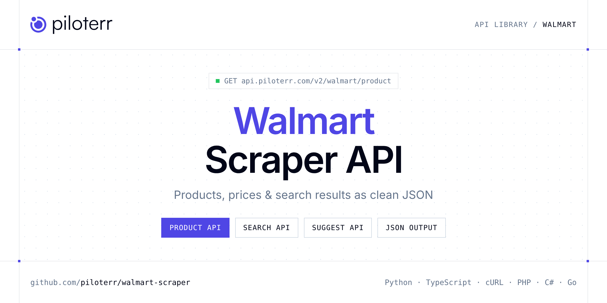

<p align="center">
  <a href="https://www.piloterr.com"></a>
</p>

# Walmart Scraper API

[](https://discord.gg/CFj3ph8aHU) [](https://app.piloterr.com) [](https://app.piloterr.com/openapi) [](LICENSE)

The **Piloterr Walmart Scraper API** lets you extract public data from Walmart as **clean, structured JSON** — no proxies, headless browsers or HTML parsing to maintain. Endpoints available in production:

- **Walmart Product API** — Extract full Walmart product page (PDP) data from a /ip/ URL: pricing, ratings, images, fulfillment, specs, badges, and availability via browser rendering.
- **Walmart Search API** — Scrape Walmart.com search result pages from a full URL and retrieve product cards with pricing, ratings, availability, and pagination via browser rendering.
- **Walmart Suggest API** — Get Walmart.com search autocomplete suggestions for a keyword via browser rendering, with optional US ZIP code localization.

Use it for price monitoring, assortment tracking, competitor analysis, product research or catalog enrichment.

| Endpoint | Path | Credits | What you get |
|---|---|---|---|
| [Walmart Product API](#walmart-product-api) | `/v2/walmart/product` | 2 | Extract full Walmart product page (PDP) data from a /ip/ URL |
| [Walmart Search API](#walmart-search-api) | `/v2/walmart/search` | 2 | Scrape Walmart.com search result pages from a full URL and retrieve product cards with pricing, ratings, availability, and pagination via browser rendering. |
| [Walmart Suggest API](#walmart-suggest-api) | `/v2/walmart/suggest` | 2 | Get Walmart.com search autocomplete suggestions for a keyword via browser rendering, with optional US ZIP code localization. |

## Table of contents

- [How it works](#how-it-works)
- [Walmart Product API](#walmart-product-api)
- [Walmart Search API](#walmart-search-api)
- [Walmart Suggest API](#walmart-suggest-api)
- [Code examples in other languages](#code-examples-in-other-languages)
- [Practical use cases](#practical-use-cases)
- [Why Piloterr?](#why-piloterr)
- [FAQ](#faq)
- [Related scrapers](#related-scrapers)
- [Support](#support)

## How it works

1. **Create a free Piloterr account** and copy your API key from the [dashboard](https://app.piloterr.com).
2. **Send a `GET` (or `POST`) request** to `https://api.piloterr.com/v2/...` with the header `x-api-key: YOUR_API_KEY`.
3. **Receive structured JSON** — Piloterr handles rendering, proxies, retries and parsing.

```bash
export PILOTERR_API_KEY="your-api-key"
pip install requests        # Python
# TypeScript: Node.js 18+ (native fetch), run with `npx tsx file.ts`
```

> Every endpoint accepts both `GET` (query string) and `POST` (JSON body with the same fields).

## Walmart Product API

Extract full Walmart product page (PDP) data from a /ip/ URL: pricing, ratings, images, fulfillment, specs, badges, and availability via browser rendering.

`GET | POST https://api.piloterr.com/v2/walmart/product` · **2 credits per request** · [Full reference](https://app.piloterr.com/openapi)

### Request parameters

| Parameter | Type | Required | Description |
|---|---|---|---|
| `query` | string | ✅ | Full Walmart product page URL. |

### Python example

```python
import json
import os
import requests

response = requests.get(
    "https://api.piloterr.com/v2/walmart/product",
    headers={"x-api-key": os.environ["PILOTERR_API_KEY"]},
    params={
        "query": "https://www.walmart.com/ip/Fresh-Rockit-Crisp-Sweet-Miniature-Apples-3lb-Tub/309762096",
    },
    timeout=120,
)
response.raise_for_status()
data = response.json()

print(json.dumps(data, indent=2, ensure_ascii=False)[:2000])
```

### TypeScript example

```typescript
type WalmartProduct = {
  id?: string;
  pac?: unknown;
  upc?: string;
  esrb?: unknown;
  idml?: {
    videos?: unknown;
    warranty?: unknown;
    drug_guide?: unknown;
    esrb_rating?: unknown;
    ingredients?: {
      ingredients?: Record<string, unknown>;
      active_ingredients?: unknown;
      inactive_ingredients?: unknown;
      active_ingredient_name?: unknown;
    };
    mpaa_rating?: unknown;
    size_charts?: unknown;
    infographics?: unknown;
    social_media?: unknown;
    ar_experience?: {
      name?: string;
      values?: string[];
    }[];
    gen_ai_details?: {
      gen_ai_concise_summary?: unknown;
      gen_ai_description_bullet?: unknown;
    };
    specifications?: {
      name?: string;
      value?: string;
    }[];
    choking_hazards?: unknown;
    enriched360_spin?: unknown;
    long_description?: string;
    short_description?: string;
    product_highlights?: {
      name?: string;
      value?: string;
      icon_url?: unknown;
    }[];
    has_marketing_description?: boolean;
    interactive_product_video?: unknown;
    interactive_product_assets?: unknown;
    product360_image_container?: unknown;
  };
  name?: string;
  type?: string;
  brand?: string;
  model?: unknown;
  badges?: {
    tags?: unknown[];
    flags?: {
      id?: string;
      key?: string;
      rank?: number;
      text?: string;
      type?: string;
      query?: string;
      style_id?: string;
      __typename?: string;
    }[];
    groups?: {
      name?: string;
      members?: Record<string, unknown>[];
      __typename?: string;
    }[];
    labels?: unknown;
    groups_v2?: {
      pos?: string;
      flow?: string;
      name?: string;
      members?: Record<string, unknown>[];
    }[];
  };
  ebooks?: unknown;
  gender?: unknown;
  pet_rx?: {
    eligible?: boolean;
    single_dispense?: unknown;
  };
  vision?: {
    age_group?: unknown;
    vision_center_approved?: boolean;
  };
  is_byod?: boolean;
  rewards?: unknown;
  rh_path?: string;
  category?: {
    path?: {
      url?: string;
      name?: string;
    }[];
    category_path_id?: string;
  };
  class_id?: string;
  location?: {
    city?: string;
    intent?: string;
    store_ids?: string[];
    address_id?: unknown;
    postal_code?: string;
    pickup_location?: {
      store_id?: string;
      access_type?: unknown;
      access_point_id?: unknown;
    };
    mp_pickup_location?: unknown;
    state_or_province_code?: string;
  };
  offer_id?: string;
  redirect?: {
    replaced_by_item_id?: string;
    replaced_by_product_id?: string;
    replaced_by_product_url_text?: string;
  };
  show_atc?: boolean;
  variants?: unknown[];
  brand_url?: string;
  [key: string]: unknown;
};

const params = new URLSearchParams({
  "query": "https://www.walmart.com/ip/Fresh-Rockit-Crisp-Sweet-Miniature-Apples-3lb-Tub/309762096",
});

const response = await fetch(`https://api.piloterr.com/v2/walmart/product?${params}`, {
  headers: { "x-api-key": process.env.PILOTERR_API_KEY! },
});
if (!response.ok) throw new Error(`Piloterr error ${response.status}: ${await response.text()}`);

const data = (await response.json()) as WalmartProduct;

console.log(JSON.stringify(data, null, 2).slice(0, 2000));
```

<details>
<summary><b>POST variant</b></summary>

```http
POST https://api.piloterr.com/v2/walmart/product
x-api-key: YOUR_API_KEY
Content-Type: application/json

{"query": "https://www.walmart.com/ip/Fresh-Rockit-Crisp-Sweet-Miniature-Apples-3lb-Tub/309762096"}
```
</details>

### Output example

Example response from the API reference, abridged — real values depend on the page you scrape.

```json
{
  "id": "40KH71FS6S1U",
  "pac": null,
  "upc": "888289403510",
  "esrb": null,
  "idml": {
    "videos": null,
    "warranty": null,
    "drug_guide": null,
    "esrb_rating": null,
    "ingredients": {
      "ingredients": {
        "name": "Ingredients",
        "value": "Fresh Produce"
      },
      "active_ingredients": null,
      "inactive_ingredients": null,
      "active_ingredient_name": null
    },
    "mpaa_rating": null,
    "size_charts": null,
    "infographics": null,
    "social_media": null,
    "ar_experience": [
      {
        "name": "Augmented Reality Experiences",
        "values": [
          "{\"ar_eligible\":\"true\",\"ar_enabled\":\"false\",\"ar_experiencetype_info\":{\"version\":\"2.0\",\"platforms\":{}},\"requestId\":\"6d13d9ca-be65-4b30-aaf6…"
        ]
      }
    ],
    "gen_ai_details": {
      "gen_ai_concise_summary": null,
      "gen_ai_description_bullet": null
    },
    "specifications": [
      {
        "name": "Plant variety",
        "value": "Rockit"
      },
      {
        "name": "Average sold by weight",
        "value": "3 Pounds"
      }
    ],
    "choking_hazards": null,
    "enriched360_spin": null,
    "long_description": "<ul>  <li>Sweet, crisp and juicy with every bite</li>  <li>Conveniently sized for on-the-go snacking</li>  <li>Perfect as a healthy treat…",
    "short_description": "Experience the perfect combination of sweetness and crispness with our Fresh Rockit Miniature Apples. Naturally grown to be miniature, th…",
    "product_highlights": [
      {
        "name": "Plant variety",
        "value": "Rockit",
        "icon_url": null
      },
      {
        "name": "Average sold by weight",
        "value": "3 Pounds",
        "icon_url": null
      }
    ],
    "has_marketing_description": false,
    "interactive_product_video": null,
    "interactive_product_assets": null,
    "product360_image_container": null
  },
  "name": "Fresh Rockit, Crisp Sweet Miniature Apples, 3lb Tub",
  "type": "Apples",
  "brand": "Rock It",
  "model": null,
  "badges": {
    "tags": [],
    "flags": [
      {
        "id": "L1200",
        "key": "CUSTOMER_PICK",
        "rank": 1,
        "text": "Overall pick",
        "type": "LABEL",
        "query": "mini apples",
        "style_id": "PRIMARY_BLUE_BOLD",
        "__typename": "BaseBadge"
      }
    ],
    "groups": [
      {
        "name": "benefits",
        "members": [
          {}
        ],
        "__typename": "UnifiedBadgeGroup"
      }
    ],
    "labels": null,
    "groups_v2": [
      {
        "pos": "ItemPageBadgeModule2",
        "flow": "HORIZONTAL",
        "name": "flags",
        "members": [
          {}
        ]
      }
    ]
  },
  "ebooks": null,
  "gender": null,
  "pet_rx": {
    "eligible": false,
    "single_dispense": null
  },
  "vision": {
    "age_group": null,
    "vision_center_approved": false
  },
  "is_byod": false,
  "rewards": null,
  "rh_path": "40000:46000:46001:46104:46231",
  "category": {
    "path": [
      {
        "url": "/cp/food/976759",
        "name": "Food"
      },
      {
        "url": "/cp/fresh-produce/976793",
        "name": "Fresh Produce"
      }
    ],
    "category_path_id": "0:976759:976793:9756351:7796396"
  },
  "class_id": "1",
  "location": {
    "city": "Sacramento",
    "intent": "SHIPPING",
    "store_ids": [
      "3081"
    ],
    "address_id": null,
    "postal_code": "95829",
    "pickup_location": {
      "store_id": "3081",
      "access_type": null,
      "access_point_id": null
    },
    "mp_pickup_location": null,
    "state_or_province_code": "CA"
  },
  "offer_id": "AC8C51F0396B4072B53EDABAA1DF222B",
  "redirect": {
    "replaced_by_item_id": "",
    "replaced_by_product_id": "",
    "replaced_by_product_url_text": ""
  },
  "show_atc": true,
  "variants": [],
  "brand_url": "/search?q=Rock+It&facet=brand:Rock+It"
}
```

### Response fields

| Field | Type | Description |
|---|---|---|
| `id` | string |  |
| `pac` | object |  |
| `upc` | string |  |
| `esrb` | object |  |
| `idml` | object |  |
| `idml.videos` | object |  |
| `idml.warranty` | object |  |
| `idml.drug_guide` | object |  |
| `idml.esrb_rating` | object |  |
| `idml.ingredients` | object |  |
| `idml.mpaa_rating` | object |  |
| `idml.size_charts` | object |  |
| `idml.infographics` | object |  |
| `idml.social_media` | object |  |
| `idml.ar_experience[]` | object[] |  |
| `idml.gen_ai_details` | object |  |
| `idml.specifications[]` | object[] |  |
| `idml.choking_hazards` | object |  |
| `idml.enriched360_spin` | object |  |
| `idml.long_description` | string |  |
| `idml.short_description` | string |  |
| `idml.product_highlights[]` | object[] |  |
| `idml.has_marketing_description` | boolean |  |
| `idml.interactive_product_video` | object |  |
| `idml.interactive_product_assets` | object |  |

## Walmart Search API

Scrape Walmart.com search result pages from a full URL and retrieve product cards with pricing, ratings, availability, and pagination via browser rendering.

`GET | POST https://api.piloterr.com/v2/walmart/search` · **2 credits per request** · [Full reference](https://app.piloterr.com/openapi)

### Request parameters

| Parameter | Type | Required | Description |
|---|---|---|---|
| `query` | string | ✅ | Full Walmart search results URL. |

### Python example

```python
import json
import os
import requests

response = requests.get(
    "https://api.piloterr.com/v2/walmart/search",
    headers={"x-api-key": os.environ["PILOTERR_API_KEY"]},
    params={
        "query": "https://www.walmart.com/search?q=apples",
    },
    timeout=120,
)
response.raise_for_status()
data = response.json()

print(json.dumps(data, indent=2, ensure_ascii=False)[:2000])
```

### TypeScript example

```typescript
type WalmartSearch = {
  results?: {
    id?: string;
    url?: string;
    name?: string;
    type?: string;
    brand?: unknown;
    image?: string;
    price?: number;
    price_info?: {
      unit_price?: string;
      line_price_display?: string;
    };
    us_item_id?: string;
    seller_name?: string;
    canonical_url?: string;
    average_rating?: number;
    fulfillment_type?: string;
    is_sponsored_flag?: boolean;
    number_of_reviews?: number;
    availability_status_v2?: {
      value?: string;
      display?: string;
    };
  }[];
  pagination?: {
    next?: boolean;
    page?: number;
    total?: number;
    max_page?: number;
  };
};

const params = new URLSearchParams({
  "query": "https://www.walmart.com/search?q=apples",
});

const response = await fetch(`https://api.piloterr.com/v2/walmart/search?${params}`, {
  headers: { "x-api-key": process.env.PILOTERR_API_KEY! },
});
if (!response.ok) throw new Error(`Piloterr error ${response.status}: ${await response.text()}`);

const data = (await response.json()) as WalmartSearch;

console.log(JSON.stringify(data, null, 2).slice(0, 2000));
```

<details>
<summary><b>POST variant</b></summary>

```http
POST https://api.piloterr.com/v2/walmart/search
x-api-key: YOUR_API_KEY
Content-Type: application/json

{"query": "https://www.walmart.com/search?q=apples"}
```
</details>

### Output example

Example response from the API reference, abridged — real values depend on the page you scrape.

```json
{
  "results": [
    {
      "id": "40KH71FS6S1U",
      "url": "https://www.walmart.com/ip/Fresh-Rockit-Crisp-Sweet-Miniature-Apples-3lb-Tub/309762096?classType=REGULAR",
      "name": "Fresh Rockit, Crisp Sweet Miniature Apples, 3lb Tub",
      "type": "REGULAR",
      "brand": null,
      "image": "https://i5.walmartimages.com/seo/Fresh-Rockit-Crisp-Sweet-Miniature-Apples-3lb-Tub_de6d6d44-507a-43e4-9bd9-d86286473870.4d6dbcb5c20088585…",
      "price": 8.97,
      "price_info": {
        "unit_price": "$2.99/lb",
        "line_price_display": "$8.97"
      },
      "us_item_id": "309762096",
      "seller_name": "example",
      "canonical_url": "/ip/Fresh-Rockit-Crisp-Sweet-Miniature-Apples-3lb-Tub/309762096?classType=REGULAR",
      "average_rating": 4.4,
      "fulfillment_type": "STORE",
      "is_sponsored_flag": true,
      "number_of_reviews": 2034,
      "availability_status_v2": {
        "value": "IN_STOCK",
        "display": "In stock"
      }
    },
    {
      "id": "2GZTW48YO9IV",
      "url": "https://www.walmart.com/ip/Fresh-Envy-Apples-3-lb-Bag/978115165?classType=REGULAR",
      "name": "Fresh Envy™ Apples, 3 lb Bag",
      "type": "REGULAR",
      "brand": null,
      "image": "https://i5.walmartimages.com/seo/Fresh-Envy-Apples-3-lb-Bag_d988dbde-f74a-4fde-a66f-b96569f9133b.87d9427485c1e5d8b3feaf0c0fde5834.jpeg?od…",
      "price": 5.37,
      "price_info": {
        "unit_price": "$1.79/lb",
        "line_price_display": "$5.37"
      },
      "us_item_id": "978115165",
      "seller_name": "example",
      "canonical_url": "/ip/Fresh-Envy-Apples-3-lb-Bag/978115165?classType=REGULAR",
      "average_rating": 4.2,
      "fulfillment_type": "STORE",
      "is_sponsored_flag": true,
      "number_of_reviews": 1172,
      "availability_status_v2": {
        "value": "IN_STOCK",
        "display": "In stock"
      }
    }
  ],
  "pagination": {
    "next": true,
    "page": 1,
    "total": 92,
    "max_page": 5
  }
}
```

### Response fields

| Field | Type | Description |
|---|---|---|
| `results[]` | object[] |  |
| `results[].id` | string |  |
| `results[].url` | string |  |
| `results[].name` | string |  |
| `results[].type` | string |  |
| `results[].brand` | object |  |
| `results[].image` | string |  |
| `results[].price` | number |  |
| `results[].price_info` | object |  |
| `results[].us_item_id` | string |  |
| `results[].seller_name` | string |  |
| `results[].canonical_url` | string |  |
| `results[].average_rating` | number |  |
| `results[].fulfillment_type` | string |  |
| `results[].is_sponsored_flag` | boolean |  |
| `results[].number_of_reviews` | integer |  |
| `results[].availability_status_v2` | object |  |
| `pagination` | object |  |
| `pagination.next` | boolean |  |
| `pagination.page` | integer |  |
| `pagination.total` | integer |  |
| `pagination.max_page` | integer |  |

## Walmart Suggest API

Get Walmart.com search autocomplete suggestions for a keyword via browser rendering, with optional US ZIP code localization.

`GET | POST https://api.piloterr.com/v2/walmart/suggest` · **2 credits per request** · [Full reference](https://app.piloterr.com/openapi)

### Request parameters

| Parameter | Type | Required | Description |
|---|---|---|---|
| `query` | string | ✅ | Search keyword for Walmart autocomplete suggestions. |
| `zipcode` | string | — | Optional US ZIP code to localize Walmart store and inventory context for suggestions. |

### Python example

```python
import json
import os
import requests

response = requests.get(
    "https://api.piloterr.com/v2/walmart/suggest",
    headers={"x-api-key": os.environ["PILOTERR_API_KEY"]},
    params={
        "query": "apples",
    },
    timeout=120,
)
response.raise_for_status()
data = response.json()

print(json.dumps(data, indent=2, ensure_ascii=False)[:2000])
```

### TypeScript example

```typescript
type WalmartSuggest = {
  results?: {
    url?: string;
    type?: string;
    image_url?: string;
    analytics_fm?: number;
    display_name?: string;
  }[];
};

const params = new URLSearchParams({
  "query": "apples",
});

const response = await fetch(`https://api.piloterr.com/v2/walmart/suggest?${params}`, {
  headers: { "x-api-key": process.env.PILOTERR_API_KEY! },
});
if (!response.ok) throw new Error(`Piloterr error ${response.status}: ${await response.text()}`);

const data = (await response.json()) as WalmartSuggest;

console.log(JSON.stringify(data, null, 2).slice(0, 2000));
```

<details>
<summary><b>POST variant</b></summary>

```http
POST https://api.piloterr.com/v2/walmart/suggest
x-api-key: YOUR_API_KEY
Content-Type: application/json

{"query": "apples"}
```
</details>

### Output example

Example response from the API reference, abridged — real values depend on the page you scrape.

```json
{
  "results": [
    {
      "url": "query=apples&typeahead=apples",
      "type": "QUERY",
      "image_url": "https://i5.walmartimages.com/asr/bcfd9451-a73b-411f-84e3-1d866f833ae8.3e996f05a24facfa2ac526d6c631401d.jpeg",
      "analytics_fm": 5,
      "display_name": "apples"
    },
    {
      "url": "query=applesauce&typeahead=apples",
      "type": "QUERY",
      "image_url": "https://i5.walmartimages.com/asr/d71c007b-3ae2-433f-9ca2-41906af71500.bff31e2bb8bdfddd3bd46ae00f50135d.jpeg",
      "analytics_fm": 5,
      "display_name": "applesauce"
    }
  ]
}
```

### Response fields

| Field | Type | Description |
|---|---|---|
| `results[]` | object[] |  |
| `results[].url` | string |  |
| `results[].type` | string |  |
| `results[].image_url` | string |  |
| `results[].analytics_fm` | integer |  |
| `results[].display_name` | string |  |

## Code examples in other languages

Ready-to-run examples live in the [`examples/`](examples) folder. Each one reads your key from the `PILOTERR_API_KEY` environment variable.

| Language | Product | Search | Suggest |
|---|---|---|---|
| cURL (Bash) | [`product`](examples/curl/product.sh) | [`search`](examples/curl/search.sh) | [`suggest`](examples/curl/suggest.sh) |
| PHP | [`product`](examples/php/product.php) | [`search`](examples/php/search.php) | [`suggest`](examples/php/suggest.php) |
| C# | [`product`](examples/csharp/Product.cs) | [`search`](examples/csharp/Search.cs) | [`suggest`](examples/csharp/Suggest.cs) |
| Go | [`product`](examples/go/product.go) | [`search`](examples/go/search.go) | [`suggest`](examples/go/suggest.go) |
| Java | [`product`](examples/java/ProductExample.java) | [`search`](examples/java/SearchExample.java) | [`suggest`](examples/java/SuggestExample.java) |
| Ruby | [`product`](examples/ruby/product.rb) | [`search`](examples/ruby/search.rb) | [`suggest`](examples/ruby/suggest.rb) |
| Node.js | [`product`](examples/nodejs/product.mjs) | [`search`](examples/nodejs/search.mjs) | [`suggest`](examples/nodejs/suggest.mjs) |

## Practical use cases

- **Price monitoring** — Track prices, promotions and availability over time to react to competitors.
- **Assortment & catalog tracking** — Follow new products, delisted items and category changes.
- **Competitor analysis** — Benchmark ranges, brands and positioning across retailers.
- **Product research** — Spot best-sellers and trends from search results.
- **Catalog enrichment** — Pull titles, images and attributes into your PIM or marketplace listings.

## Why Piloterr?

- **No infrastructure** — no proxies, headless browsers or CAPTCHA solving to run yourself.
- **Structured JSON** — stable, documented fields instead of brittle HTML selectors.
- **Pay per request** — transparent credit cost per endpoint, failed requests are retried for you.
- **One API key, hundreds of sources** — Walmart plus many other e-commerce, search and company data endpoints in the [Piloterr library](https://www.piloterr.com/library).
- **Any language** — plain HTTPS + JSON, with examples for Python, TypeScript, cURL, PHP, C#, Go, Java, Ruby and Node.js.

## FAQ

### Is it legal to scrape Walmart?

Collecting publicly available data is generally allowed in many jurisdictions, but rules depend on your country, the data you collect and how you use it. Avoid personal data unless you have a lawful basis, respect the website's terms where they apply, and get legal advice for your specific use case. This is not legal advice.

### Do I need proxies or a headless browser?

No. Piloterr handles rendering, proxy rotation and retries on its side. You only send an HTTPS request with your `x-api-key` header and receive JSON.

### How much does a request cost?

Credits per call: `/v2/walmart/product` **2**, `/v2/walmart/search` **2**, `/v2/walmart/suggest` **2**. See the [Piloterr website](https://www.piloterr.com) for plans.

### What data does the Walmart API return?

Each endpoint returns structured JSON: **Walmart Product** — `id`, `pac`, `upc`, `esrb`, `idml`, `idml.videos`; **Walmart Search** — `results[]`, `results[].id`, `results[].url`, `results[].name`, `results[].type`, `results[].brand`; **Walmart Suggest** — `results[]`, `results[].url`, `results[].type`, `results[].image_url`, `results[].analytics_fm`, `results[].display_name`.

### Which languages are supported?

Any language that can make an HTTP request. This README shows Python and TypeScript; the [`examples/`](examples) folder contains cURL, PHP, C#, Go, Java, Ruby and Node.js.

## Related scrapers

- [About You Scraper API](https://github.com/piloterr/aboutyou-scraper)
- [Action Scraper API](https://github.com/piloterr/action-scraper)
- [Aldi Scraper API](https://github.com/piloterr/aldi-scraper)
- [Alibaba Scraper API](https://github.com/piloterr/alibaba-scraper)
- [AliExpress Scraper API](https://github.com/piloterr/aliexpress-scraper)
- [Allegro Scraper API](https://github.com/piloterr/allegro-scraper)
- [All Piloterr scrapers on GitHub](https://github.com/piloterr)

## Support

- 💬 Join the [Piloterr Discord](https://discord.gg/CFj3ph8aHU) to ask questions and share what you build.
- 📚 Browse the [API reference (OpenAPI)](https://app.piloterr.com/openapi) and the [Piloterr library](https://www.piloterr.com/library).
- 🔑 [Get your API key](https://app.piloterr.com).

---

<p align="center">
  <a href="https://www.piloterr.com">
    <picture>
      <source media="(prefers-color-scheme: dark)" srcset="images/logo-dark.svg">
      
    </picture>
  </a>
  <br>
  <sub>Built by <a href="https://www.piloterr.com">Piloterr</a> — web scraping APIs for e-commerce, search, real estate and more, one API key.</sub>
</p>

<sub>Walmart is a trademark of its respective owner. This repository is not affiliated with or endorsed by Walmart. Examples are released under the MIT license.</sub>
